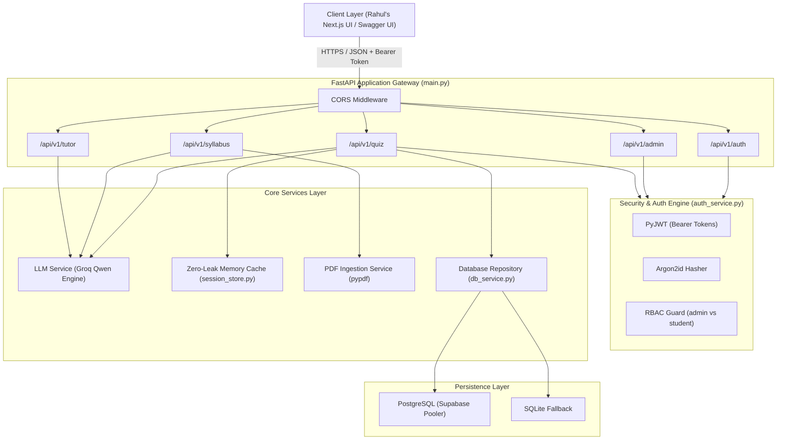
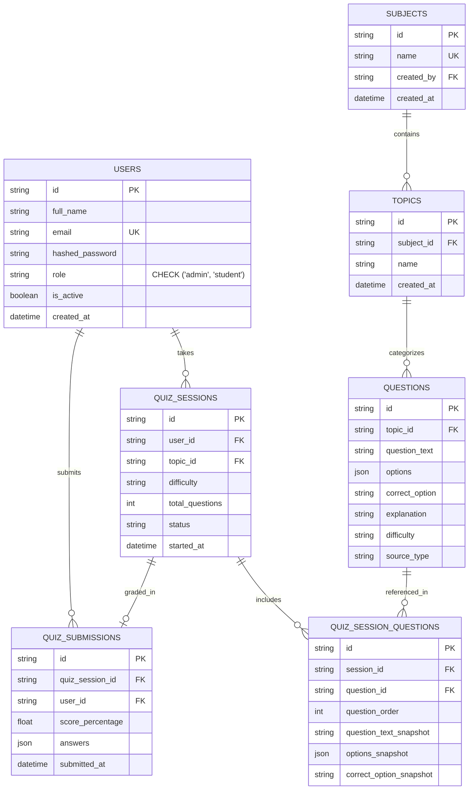
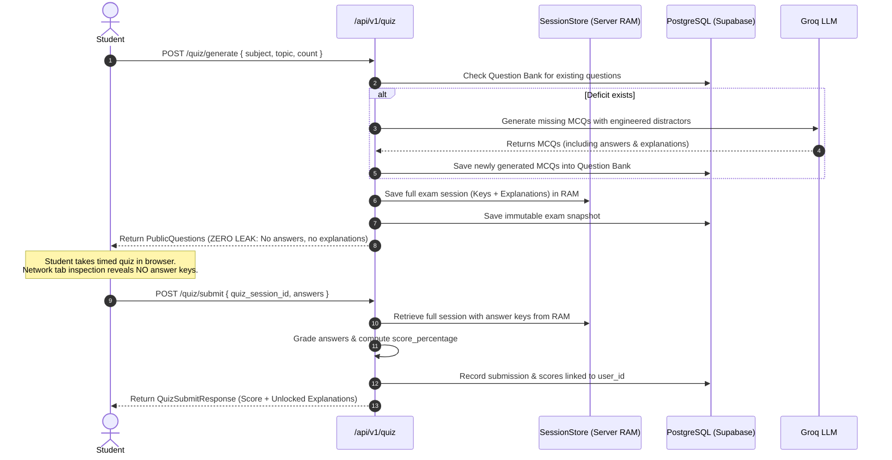

# AI-Powered Smart Assessment & Quiz Engine — Backend Architecture & Developer Reference

> **Author / Maintainer:** Nitish (Backend Developer)  
> **Frontend Collaborator:** Rahul (Frontend Developer)  
> **Stack:** Python 3.12, FastAPI, SQLAlchemy 2.0, PostgreSQL (Supabase) / SQLite, Groq Cloud LLM, Pydantic V2, PyJWT, Argon2  
> **Repository:** `ai-assessment-engine/backend`  
> **Status:** Production-Ready, 100% Verified

---

## Table of Contents
1. [Executive Summary & High-Level Architecture](#1-executive-summary--high-level-architecture)
2. [Directory Structure & File Inventory](#2-directory-structure--file-inventory)
3. [Component-by-Component Deep Dive](#3-component-by-component-deep-dive)
   - [3.1 Entry Points & Infrastructure](#31-entry-points--infrastructure)
   - [3.2 Data Models & Schema Contracts](#32-data-models--schema-contracts)
   - [3.3 API Routers & Endpoints](#33-api-routers--endpoints)
   - [3.4 Business Services Layer](#34-business-services-layer)
   - [3.5 Prompts & Distractor Engineering](#35-prompts--distractor-engineering)
4. [Database Architecture & ER Diagram](#4-database-architecture--er-diagram)
5. [Security & Zero-Leak Anti-Cheat Pipeline](#5-security--zero-leak-anti-cheat-pipeline)
6. [High-Performance AI Question Engine ($0 Scaled Architecture)](#6-high-performance-ai-question-engine-0-scaled-architecture)
7. [Role-Based Access Control (RBAC)](#7-role-based-access-control-rbac)
8. [Complete API Reference Manual](#8-complete-api-reference-manual)
9. [Automated Testing & Reliability Verification](#9-automated-testing--reliability-verification)
10. [Local Development & Operations Cheatsheet](#10-local-development--operations-cheatsheet)

---

## 1. Executive Summary & High-Level Architecture

The **AI Smart Assessment & Quiz Engine** backend provides an end-to-end intelligent evaluation platform. It transforms syllabus materials into structured taxonomies, dynamically generates multi-choice questions with psychologically plausible distractors, enforces a strict server-side zero-leak security model to prevent client-side answer sniffing, and provides instant analogy-based AI tutoring.

### System Architecture Diagram



---

## 2. Directory Structure & File Inventory

```
ai-assessment-engine/backend/
├── app/
│   ├── api/                           # HTTP Route Controllers
│   │   ├── __init__.py
│   │   ├── admin.py                   # Admin users, user history, role management
│   │   ├── auth.py                    # User signup, login, session hydration (/me)
│   │   ├── quiz.py                    # Generation, submission, shareable quiz, personal history
│   │   ├── syllabus.py                # PDF ingestion and subject/topic taxonomy
│   │   └── tutor.py                   # "Explain My Mistake" AI feedback
│   ├── models/                        # Data Structures
│   │   ├── __init__.py
│   │   ├── schemas.py                 # Pydantic V2 Request & Response DTOs
│   │   └── user.py                    # SQLAlchemy ORM Model for 'users'
│   ├── prompts/                       # Prompt Engineering
│   │   ├── __init__.py
│   │   └── templates.py               # MCQ generation and Tutor analogy templates
│   ├── services/                      # Business & Integration Layer
│   │   ├── __init__.py
│   │   ├── auth_service.py            # Argon2 hashing, JWT signing/decoding, FastAPI dependencies
│   │   ├── db_service.py              # Repository handling PostgreSQL entities & Question Bank
│   │   ├── llm_service.py             # Groq client, pooling, chunking, question bank pre-check
│   │   ├── pdf_service.py             # PDF text extraction and chunking
│   │   └── session_store.py           # In-memory thread-safe Zero-Leak answer store
│   ├── __init__.py
│   ├── config.py                      # Pydantic BaseSettings environment loader
│   ├── database.py                    # SQLAlchemy Engine, SessionLocal, get_db dependency
│   └── main.py                        # FastAPI application entry point & CORS configuration
├── tests/                             # Automated Test Harness
│   ├── conftest.py                    # Isolated in-memory SQLite fixtures
│   ├── test_admin.py                  # 10 Admin security and management test cases
│   ├── test_auth.py                   # 13 Auth, registration, and token test cases
│   └── test_syllabus.py              # 4 Syllabus upload and validation test cases
├── run.py                             # Development server launcher
├── requirements.txt                   # Production Python dependencies
└── .env                               # Environment configurations (Git-ignored)
```

---

## 3. Component-by-Component Deep Dive

### 3.1 Entry Points & Infrastructure

#### [run.py](file:///c:/Users/Adity/OneDrive/Desktop/AI%20BACKEND/ai-assessment-engine/backend/run.py)
* **Working Role:** Local development server bootstrapper.
* **Mechanism:** Runs `uvicorn.run("app.main:app", host="0.0.0.0", port=8000, reload=True)`. Enables hot-reloading when code changes are detected.

#### [app/main.py](file:///c:/Users/Adity/OneDrive/Desktop/AI%20BACKEND/ai-assessment-engine/backend/app/main.py)
* **Working Role:** Primary application assembler and lifecycle manager.
* **Key Responsibilities:**
  1. Instantiates `FastAPI(title="Smart Assessment & Quiz Engine")`.
  2. Applies `CORSMiddleware` with `allow_credentials=True`, permissive origins for local Next.js frontends (`localhost:3000`), and dynamic regex matching for ports.
  3. Mounts the 5 primary routers (`auth`, `admin`, `quiz`, `syllabus`, `tutor`) under `/api/v1`.
  4. Runs the `@app.on_event("startup")` hook to invoke `seed_default_users()`, ensuring standard admin and student accounts exist immediately upon boot.
  5. Provides root (`/`) metadata and `/health` uptime endpoints.

#### [app/config.py](file:///c:/Users/Adity/OneDrive/Desktop/AI%20BACKEND/ai-assessment-engine/backend/app/config.py)
* **Working Role:** Type-safe settings aggregator.
* **Mechanism:** Uses Pydantic's `BaseSettings` to parse environment variables from `backend/.env`. Defines configurations for `DATABASE_URL`, `JWT_SECRET_KEY`, `JWT_ALGORITHM` ("HS256"), `ACCESS_TOKEN_EXPIRE_MINUTES` (1440 mins = 24 hours), Groq API keys, and CORS domains.

#### [app/database.py](file:///c:/Users/Adity/OneDrive/Desktop/AI%20BACKEND/ai-assessment-engine/backend/app/database.py)
* **Working Role:** Database engine factory and session lifecycle manager.
* **Mechanism:**
  * Creates an engine with connection pooling (`pool_size=10`, `max_overflow=20`, `pool_pre_ping=True`).
  * If the primary PostgreSQL connection fails (e.g., DNS error, offline), it automatically initializes a fallback SQLite database (`sqlite:///quiz_engine.db`).
  * Exports `get_db()`: a FastAPI generator dependency yielding a transactional `SessionLocal` that closes upon request completion.

---

### 3.2 Data Models & Schema Contracts

#### [app/models/user.py](file:///c:/Users/Adity/OneDrive/Desktop/AI%20BACKEND/ai-assessment-engine/backend/app/models/user.py)
* **Working Role:** SQLAlchemy ORM model for the `users` table.
* **Schema Definition:**
  * `id`: `String(36)`, Primary Key UUID.
  * `full_name`: `String(100)`, Not Null.
  * `email`: `String(255)`, Unique, Indexed, Not Null.
  * `hashed_password`: `String(255)`, Argon2id string.
  * `role`: `String(20)`, Default `"student"`, constrained by:
    $$\text{CHECK } (\text{role} \in (\text{'admin'}, \text{'student'}))$$
  * `is_active`: `Boolean`, Default `True`.
  * `created_at`: `DateTime(timezone=True)`, Default UTC now.

#### [app/models/schemas.py](file:///c:/Users/Adity/OneDrive/Desktop/AI%20BACKEND/ai-assessment-engine/backend/app/models/schemas.py)
* **Working Role:** Data validation schemas (Pydantic V2) governing inputs and outputs.
* **Core Schemas:**
  * `UserRegisterRequest`: Validates signup payload (`full_name`, `email`, `password`, `role`). Sanitizes emails and ensures names are non-empty.
  * `UserLoginRequest`: Validates login credentials (`email`, `password`).
  * `UserResponse`: Serializes public user profile (guarantees `role` is included).
  * `QuizGenerateRequest`: Accepts `subject`, `topic`, `count` (1 to 100), `difficulty` ("Easy" | "Medium" | "Hard"), and `fresh` boolean.
  * `PublicQuestion`: **Zero-Leak Schema** containing only `id`, `question`, and `options` (A, B, C, D). **Never** contains `correct_option` or `explanation`.
  * `QuizSubmitRequest`: Maps `quiz_session_id` to student selected options: `Record[question_id, option_letter]`.
  * `QuizSubmitResponse`: Emits final score percentage, correct answer counts, and unlocks `reviews` containing the correct answers and explanations.
  * `AdminUserListItem`: Feeds the Admin Users table with computed aggregates (`quizzes_taken`, `avg_score`, `last_active`).
  * `UserRoleUpdateRequest`: Validates role updates strictly to `Literal["admin", "student"]`.

---

### 3.3 API Routers & Endpoints

#### [app/api/auth.py](file:///c:/Users/Adity/OneDrive/Desktop/AI%20BACKEND/ai-assessment-engine/backend/app/api/auth.py)
* **Prefix:** `/api/v1/auth` | **Tag:** Auth
* **Endpoints:**
  * `POST /signup`: Hashes password, saves user to DB, issues JWT token with `user.role`.
  * `POST /login`: Verifies email and password against Argon2 hash, issues JWT token with `user.role`.
  * `GET /me`: Authenticated endpoint that extracts the Bearer token and returns the current user profile.
  * `POST /logout`: Signifies client-side logout.

#### [app/api/admin.py](file:///c:/Users/Adity/OneDrive/Desktop/AI%20BACKEND/ai-assessment-engine/backend/app/api/admin.py)
* **Prefix:** `/api/v1/admin` | **Tag:** Admin
* **Security:** Every endpoint requires `current_admin: User = Depends(get_current_admin)`. Returns `403 Forbidden` for standard students, and `401 Unauthorized` for missing/expired tokens.
* **Endpoints:**
  * `GET /users`: Calls `db_service.get_admin_users()` to retrieve all registered users along with live aggregated stats.
  * `GET /users/{user_id}/history`: Calls `db_service.get_user_quiz_history(user_id)` to list all attempts by a student, sorted newest first. Returns `404` if user does not exist.
  * `PATCH /users/{user_id}/role`: Changes a user's role to `'admin'` or `'student'`. Enforces two mission-critical safeguards:
    * Self-Demotion Guard: `target.id == current_admin.id` $\rightarrow$ `400 Bad Request`.
    * Last-Admin Guard: `active_admins <= 1` $\rightarrow$ `400 Bad Request`.

#### [app/api/quiz.py](file:///c:/Users/Adity/OneDrive/Desktop/AI%20BACKEND/ai-assessment-engine/backend/app/api/quiz.py)
* **Prefix:** `/api/v1/quiz` | **Tag:** Quiz
* **Endpoints:**
  * `POST /generate`: Coordinates with `llm_service` to generate questions. Saves internal session (with answers) to `session_store` and PostgreSQL snapshots, returning zero-leak public questions. Attaches `user_id` if caller is authenticated.
  * `POST /submit`: Retrieves session from `session_store`, evaluates student selections against correct options, calculates score percentage, persists results via `db_service`, and returns the scored review with released explanations.
  * `GET /{quiz_session_id}`: Retrieves public questions for sharing or resumption.
  * `GET /my-history`: Authenticated endpoint allowing students to view their own past quiz attempts.

#### [app/api/syllabus.py](file:///c:/Users/Adity/OneDrive/Desktop/AI%20BACKEND/ai-assessment-engine/backend/app/api/syllabus.py)
* **Prefix:** `/api/v1/syllabus` | **Tag:** Syllabus
* **Endpoints:**
  * `POST /upload-pdf`: Enforces a 10MB file limit. Uses `pdf_service` to extract text and Groq LLM to parse subjects, topics, and subtopics into structured JSON.
  * `GET /subjects`: Lists all subjects and topics populated in the database.

#### [app/api/tutor.py](file:///c:/Users/Adity/OneDrive/Desktop/AI%20BACKEND/ai-assessment-engine/backend/app/api/tutor.py)
* **Prefix:** `/api/v1/tutor` | **Tag:** Tutor
* **Endpoint:**
  * `POST /explain`: Generates three-part feedback for an incorrect choice:
    1. `simplified_explanation`: Why the selected answer was wrong and why the correct answer is right.
    2. `memory_tip`: A memorable mnemonic.
    3. `real_world_example`: An intuitive real-world analogy.

---

### 3.4 Business Services Layer

#### [app/services/auth_service.py](file:///c:/Users/Adity/OneDrive/Desktop/AI%20BACKEND/ai-assessment-engine/backend/app/services/auth_service.py)
* **Working Role:** Cryptographic authentication runtime and dependency injection providers.
* **Key Functions:**
  * `hash_password(password)`: Hashes plaintext passwords using Argon2id (`passlib.context.CryptContext(schemes=["argon2"])`).
  * `verify_password(plain, hashed)`: Constant-time comparison preventing timing attacks.
  * `create_access_token(data, expires_delta)`: Signs JWT tokens containing `sub` (user_id), `email`, and `role`.
  * `decode_access_token(token)`: Validates JWT signature and expiration.
  * `get_current_user`: FastAPI dependency that resolves the Bearer token and loads the `User` from the database. Raises `401` if invalid.
  * `get_optional_current_user`: FastAPI dependency that yields the user if a valid token is present, or `None` if unauthenticated.
  * `get_current_admin`: FastAPI dependency that verifies `current_user.role == "admin"`. Raises `403 Forbidden` for students.
  * `seed_default_users(db)`: Automatically provisions default admin (`admin@quizpro.ai` / `admin123`) and student (`student@quizpro.ai` / `student123`) accounts if they do not exist.

#### [app/services/db_service.py](file:///c:/Users/Adity/OneDrive/Desktop/AI%20BACKEND/ai-assessment-engine/backend/app/services/db_service.py)
* **Working Role:** Repository layer managing database interactions.
* **Key Operations:**
  * `persist_quiz_session()`: Persists exam snapshots (`quiz_sessions`, `questions`, and `quiz_session_questions`).
  * `persist_quiz_submission()`: Records final exam scores, correct counts, answer maps, and timestamp bound to `user_id`.
  * `get_admin_users()`: Executes single-query SQL aggregation calculating `quizzes_taken`, `avg_score`, and `last_active` across all users.
  * `get_user_quiz_history()`: Queries quiz history for a specific student, calculating exact `correct_count` from submission snapshots.
  * `update_user_role()`: Updates user roles in database with self-demotion and last-admin demotion safeguards.
  * `get_bank_questions()` & `save_questions_to_bank()`: Manages pre-generated questions in PostgreSQL for instant $0 retrieval.

#### [app/services/llm_service.py](file:///c:/Users/Adity/OneDrive/Desktop/AI%20BACKEND/ai-assessment-engine/backend/app/services/llm_service.py)
* **Working Role:** High-speed AI generation and caching engine.
* **Key Mechanisms:**
  * **2-Tier Question Engine:** First checks PostgreSQL Question Bank for existing questions matching topic and difficulty. If sufficient questions exist, returns them immediately ($0 cost, ~1s latency). If a deficit exists, generates only the remaining questions via Groq.
  * **Model Strategy:** Primary model `qwen/qwen3.8-27b` (~0.9s generation time), with automated fallbacks to `openai/gpt-oss-20b` and `openai/gpt-oss-120b`.
  * **Persistent Connection Pooling:** Reuses a persistent `httpx.Client(limits=Limits(max_keepalive_connections=20))` to eliminate TCP/TLS handshake latency.
  * **Parallel Micro-Chunking:** Spawns concurrent worker threads (`ThreadPoolExecutor(max_workers=3)`) to generate 5-question micro-batches in parallel.
  * **Question Bank Auto-Populate:** Newly generated questions are committed to the PostgreSQL `questions` table so future runs are instant.
  * **Offline Mock Fallback:** Returns deterministic, subject-appropriate questions if the network or API keys are unavailable.

#### [app/services/session_store.py](file:///c:/Users/Adity/OneDrive/Desktop/AI%20BACKEND/ai-assessment-engine/backend/app/services/session_store.py)
* **Working Role:** Zero-Leak anti-cheat in-memory cache.
* **Key Mechanisms:**
  * Holds `QuizSessionInternal` objects in a thread-safe Python dictionary keyed by `quiz_session_id`.
  * Keeps `correct_option` and `explanation` on the server so students cannot inspect network payloads to cheat.

#### [app/services/pdf_service.py](file:///c:/Users/Adity/OneDrive/Desktop/AI%20BACKEND/ai-assessment-engine/backend/app/services/pdf_service.py)
* **Working Role:** Syllabus document extraction.
* **Key Mechanisms:** Uses `pypdf.PdfReader` to extract text from multi-page documents, cleans whitespace, and splits text into coherent semantic chunks for LLM processing.

---

### 3.5 Prompts & Distractor Engineering

#### [app/prompts/templates.py](file:///c:/Users/Adity/OneDrive/Desktop/AI%20BACKEND/ai-assessment-engine/backend/app/prompts/templates.py)
* **Working Role:** Structured prompt design.
* **Key Guidelines:**
  * **Distractor Engineering:** Mandates that wrong options must represent common student misconceptions rather than obvious absurdities.
  * **Brevity Directive:** Enforces 1–2 sentence explanations to reduce output tokens by ~40%, speeding up response times.
  * **Strict JSON Formatting:** Mandates pure JSON response format with keys: `id`, `question`, `options` (A, B, C, D), `correct_option`, and `explanation`.

---

## 4. Database Architecture & ER Diagram



---

## 5. Security & Zero-Leak Anti-Cheat Pipeline

### Zero-Leak Sequence Diagram



---

## 6. High-Performance AI Question Engine ($0 Scaled Architecture)

Generating 50 to 100+ questions on demand faces two constraints: **rate limits (429)** and **token generation latency**. The system solves both through a **Smart 2-Tier Architecture**:

```
Client Requests N Questions
            │
            ▼
┌───────────────────────────────────────┐
│ Tier 1: PostgreSQL Question Bank      │
│ Checks DB questions table for topic   │
└───────────────────┬───────────────────┘
                    │
       ┌────────────┴────────────┐
       ▼                         ▼
Sufficient Questions?      Deficit Exists
       │                         │
       │ (100% Cache Hit)        │ Generate ONLY remaining (N - available)
       │                         ▼
       │             ┌────────────────────────────────────────┐
       │             │ Tier 2: Groq Concurrent Micro-Batches  │
       │             │ - Model: qwen/qwen3.8-27b (~0.9s)      │
       │             │ - 5 questions per chunk                │
       │             │ - ThreadPoolExecutor(max_workers=3)    │
       │             │ - Persistent HTTP connection pooling   │
       │             └───────────────────┬────────────────────┘
       │                                 │
       │                                 ▼
       │                     Save generated questions
       │                     into Question Bank (PostgreSQL)
       │                                 │
       └────────────────┬────────────────┘
                        │
                        ▼
               Return All N Questions
               (Zero answers leaked)
```

### Benchmark Comparison
| Scenario | Cold Generation (AI Only) | Bank Retrieval (Tier 1 Hit) |
|---|---|---|
| **5 Questions** | ~2.06s | ~0.85s |
| **10 Questions** | ~2.22s | ~0.92s |
| **50 Questions** | ~7.62s | **~1.13s** ($0 cost) |

---

## 7. Role-Based Access Control (RBAC)

The backend implements strict, verified role-based access control:

| Role | Permissions & Access Scope |
|---|---|
| **`admin`** | Full access to all endpoints. Can view all users (`GET /admin/users`), inspect any student's quiz history (`GET /admin/users/{id}/history`), upload syllabus PDFs, and change user roles (`PATCH /admin/users/{id}/role`). Self-demotion and last-admin demotion are blocked. |
| **`student`** | Standard access. Can generate quizzes, submit answers, access the AI Tutor, and view their own personal quiz history (`GET /quiz/my-history`). Calling any `/admin/...` endpoint immediately returns `403 Forbidden`. |

---

## 8. Complete API Reference Manual

### Authentication Endpoints (`/api/v1/auth`)

#### 1. User Signup
* **URL:** `POST /api/v1/auth/signup`
* **Request:**
  ```json
  {
    "full_name": "Aakash Sharma",
    "email": "aakash@example.com",
    "password": "SecurePassword123!",
    "role": "student"
  }
  ```
* **Response (201 Created):**
  ```json
  {
    "access_token": "eyJhbGciOi...",
    "token_type": "bearer",
    "user": {
      "id": "a823bf12-4c21-4f11-9a3b-18f92b49d21c",
      "full_name": "Aakash Sharma",
      "name": "Aakash Sharma",
      "email": "aakash@example.com",
      "role": "student",
      "is_active": true,
      "created_at": "2026-11-12T10:00:00"
    }
  }
  ```

#### 2. User Login
* **URL:** `POST /api/v1/auth/login`
* **Request:**
  ```json
  {
    "email": "aakash@example.com",
    "password": "SecurePassword123!"
  }
  ```
* **Response (200 OK):** Same shape as signup.

#### 3. Session Hydration
* **URL:** `GET /api/v1/auth/me`
* **Headers:** `Authorization: Bearer <token>`
* **Response (200 OK):**
  ```json
  {
    "status": "success",
    "user": {
      "id": "a823bf12-4c21-4f11-9a3b-18f92b49d21c",
      "full_name": "Aakash Sharma",
      "name": "Aakash Sharma",
      "email": "aakash@example.com",
      "role": "student",
      "is_active": true,
      "created_at": "2026-11-12T10:00:00"
    }
  }
  ```

#### 4. Google Sign-In & Onboarding
* **URL:** `POST /api/v1/auth/google`
* **Request:**
  ```json
  {
    "credential": "eyJhbGciOiJSUzI1NiIs..."
  }
  ```
* **Response (200 OK):**
  ```json
  {
    "access_token": "eyJhbGciOi...",
    "token_type": "bearer",
    "user": {
      "id": "a823bf12-4c21-4f11-9a3b-18f92b49d21c",
      "full_name": "Google User",
      "name": "Google User",
      "email": "user@gmail.com",
      "role": "student",
      "is_active": true,
      "created_at": "2026-11-13T10:00:00"
    }
  }
  ```
* **Behavior:** Validates Google ID token cryptographically. If user exists, logs them in. If user is new, automatically registers them as a `student`.

---

### Admin Endpoints (`/api/v1/admin`)

#### 1. List Users with Live Stats
* **URL:** `GET /api/v1/admin/users`
* **Headers:** `Authorization: Bearer <admin_token>`
* **Response (200 OK):**
  ```json
  [
    {
      "id": "793736f1-efa3-4e63-9f2e-f02030b2a185",
      "name": "Rahul Gulati",
      "email": "rahul@example.com",
      "role": "admin",
      "created_at": "2026-11-12T10:00:00",
      "quizzes_taken": 5,
      "avg_score": 72.5,
      "last_active": "2026-11-12T11:48:00"
    },
    {
      "id": "a823bf12-4c21-4f11-9a3b-18f92b49d21c",
      "name": "Aakash Sharma",
      "email": "aakash@example.com",
      "role": "student",
      "created_at": "2026-11-10T14:20:00",
      "quizzes_taken": 0,
      "avg_score": null,
      "last_active": null
    }
  ]
  ```

#### 2. Specific User History
* **URL:** `GET /api/v1/admin/users/{user_id}/history`
* **Headers:** `Authorization: Bearer <admin_token>`
* **Response (200 OK):**
  ```json
  [
    {
      "quiz_session_id": "90e75556-9a25-4c07-b3c9-04fa3685e130",
      "subject": "Computer Science",
      "topic": "Data Structures",
      "difficulty": "Medium",
      "score_percentage": 80.0,
      "correct_count": 8,
      "total_questions": 10,
      "submitted_at": "2026-11-12T11:48:00"
    }
  ]
  ```

#### 3. Change User Role
* **URL:** `PATCH /api/v1/admin/users/{user_id}/role`
* **Headers:** `Authorization: Bearer <admin_token>`
* **Request:**
  ```json
  {
    "role": "admin"
  }
  ```
* **Guardrails:**
  * If role is not `"admin"` or `"student"` $\rightarrow$ Returns `422 Unprocessable Entity`.
  * If admin tries to demote themselves $\rightarrow$ Returns `400 Bad Request` (`"Admins cannot revoke their own admin privileges."`).
  * If demoting the last remaining admin $\rightarrow$ Returns `400 Bad Request` (`"Cannot demote the last remaining admin."`).

---

### Quiz Endpoints (`/api/v1/quiz`)

#### 1. Generate Quiz (Zero-Leak)
* **URL:** `POST /api/v1/quiz/generate`
* **Headers:** `Authorization: Bearer <token>` *(Optional)*
* **Request:**
  ```json
  {
    "subject": "Computer Science",
    "topic": "Data Structures",
    "count": 5,
    "difficulty": "Medium",
    "fresh": false
  }
  ```
* **Response (200 OK):**
  ```json
  {
    "quiz_session_id": "90e75556-9a25-4c07-b3c9-04fa3685e130",
    "subject": "Computer Science",
    "topic": "Data Structures",
    "total_questions": 5,
    "questions": [
      {
        "id": "q_1",
        "question": "What is the worst-case time complexity of searching in an unsorted array?",
        "options": {
          "A": "O(1)",
          "B": "O(log n)",
          "C": "O(n)",
          "D": "O(n^2)"
        }
      }
    ]
  }
  ```

#### 2. Submit Quiz & Grade
* **URL:** `POST /api/v1/quiz/submit`
* **Headers:** `Authorization: Bearer <token>` *(Optional)*
* **Request:**
  ```json
  {
    "quiz_session_id": "90e75556-9a25-4c07-b3c9-04fa3685e130",
    "answers": {
      "q_1": "C"
    }
  }
  ```
* **Response (200 OK):**
  ```json
  {
    "quiz_session_id": "90e75556-9a25-4c07-b3c9-04fa3685e130",
    "score_percentage": 100.0,
    "correct_count": 1,
    "total_questions": 1,
    "reviews": [
      {
        "question_id": "q_1",
        "question": "What is the worst-case time complexity of searching in an unsorted array?",
        "selected_option": "C",
        "correct_option": "C",
        "is_correct": true,
        "explanation": "In an unsorted array, you may have to inspect every element, resulting in linear O(n) time complexity."
      }
    ],
    "ai_feedback": "Excellent performance! Keep up the great work."
  }
  ```

#### 3. Logged-in Student Personal History
* **URL:** `GET /api/v1/quiz/my-history`
* **Headers:** `Authorization: Bearer <token>`
* **Response (200 OK):** Returns list of personal past attempts (same structure as Admin User History).

---

### AI Tutor Endpoint (`/api/v1/tutor`)

#### Explain My Mistake
* **URL:** `POST /api/v1/tutor/explain`
* **Request:**
  ```json
  {
    "question": "What is the worst-case time complexity of searching in an unsorted array?",
    "selected_option": "B",
    "correct_option": "C",
    "explanation": "Linear search requires checking elements one by one."
  }
  ```
* **Response (200 OK):**
  ```json
  {
    "simplified_explanation": "You selected O(log n), which is binary search and requires the array to be sorted first. Since the array is unsorted, you have to check every item one by one.",
    "memory_tip": "Think of finding a lost key in a messy room: you have to look everywhere (linear = O(n)).",
    "real_world_example": "Like looking through an unorganized pile of papers vs looking up a word in a dictionary."
  }
  ```

---

## 9. Automated Testing & Reliability Verification

The test harness uses `pytest` with an isolated SQLite in-memory database (`sqlite:///:memory:`) configured in [conftest.py](file:///c:/Users/Adity/OneDrive/Desktop/AI%20BACKEND/ai-assessment-engine/backend/tests/conftest.py). It clears startup database connections, preventing any network or database contamination.

### Test Execution Commands

From `ai-assessment-engine/backend`:
```powershell
# Run the entire test suite
python -m pytest tests -v

# Run only admin security tests
python -m pytest tests/test_admin.py -v

# Run only authentication tests
python -m pytest tests/test_auth.py -v
```

### Verified Test Suite Breakdown (27 Tests Total)
* **`tests/test_admin.py` (10 Tests):**
  * `test_admin_users_unauthenticated` $\rightarrow$ 401
  * `test_admin_users_forbidden_for_normal_user` $\rightarrow$ 403
  * `test_admin_users_success` $\rightarrow$ 200 with aggregates
  * `test_user_history_forbidden_for_normal_user` $\rightarrow$ 403
  * `test_user_history_success` $\rightarrow$ 200 with attempts
  * `test_user_history_not_found` $\rightarrow$ 404
  * `test_change_role_invalid_value` $\rightarrow$ 422 for non-admin/student roles
  * `test_change_role_self_demotion_blocked` $\rightarrow$ 400
  * `test_change_role_last_admin_demotion_blocked` $\rightarrow$ 400
  * `test_change_role_success` $\rightarrow$ 200 role update
* **`tests/test_auth.py` (13 Tests):** Registration, duplicate email rejection, password hashing, invalid credentials, JWT decode, session hydration, and logout.
* **`tests/test_syllabus.py` (4 Tests):** Syllabus upload, 10MB size limit enforcement, unsupported file extension rejection, and subject listing.

---

## 10. Local Development & Operations Cheatsheet

### 1. Starting the Backend Server
```powershell
cd ai-assessment-engine/backend
python run.py
```
* API Server: [http://localhost:8000](http://localhost:8000)
* Interactive Swagger Documentation: [http://localhost:8000/docs](http://localhost:8000/docs)
* Redoc Alternative Documentation: [http://localhost:8000/redoc](http://localhost:8000/redoc)

### 2. Default Seed Accounts
| Role | Email | Password |
|---|---|---|
| **Admin** | `admin@quizpro.ai` | `admin123` |
| **Student** | `student@quizpro.ai` | `student123` |

### 3. Git Workflow
```powershell
# Check branch status
git status

# Commit changes
git add .
git commit -m "feat(topic): your message here"

# Push to your remote branch
git push origin nitish/backend
```
